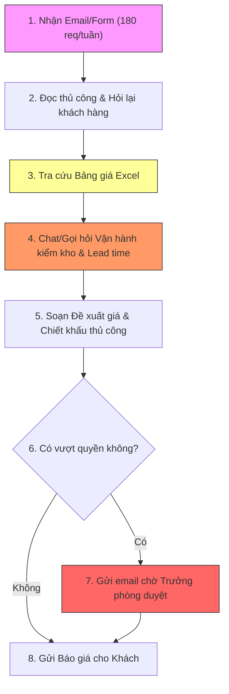
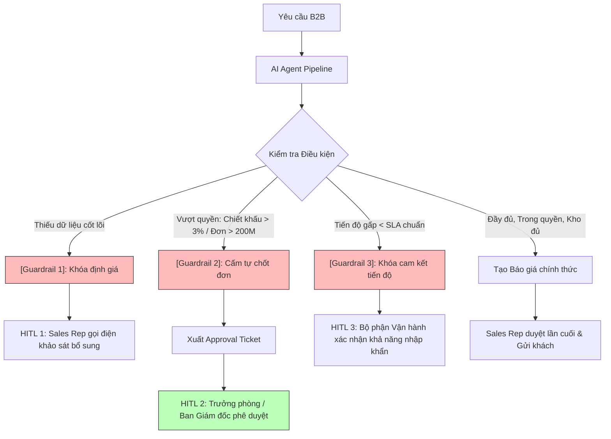
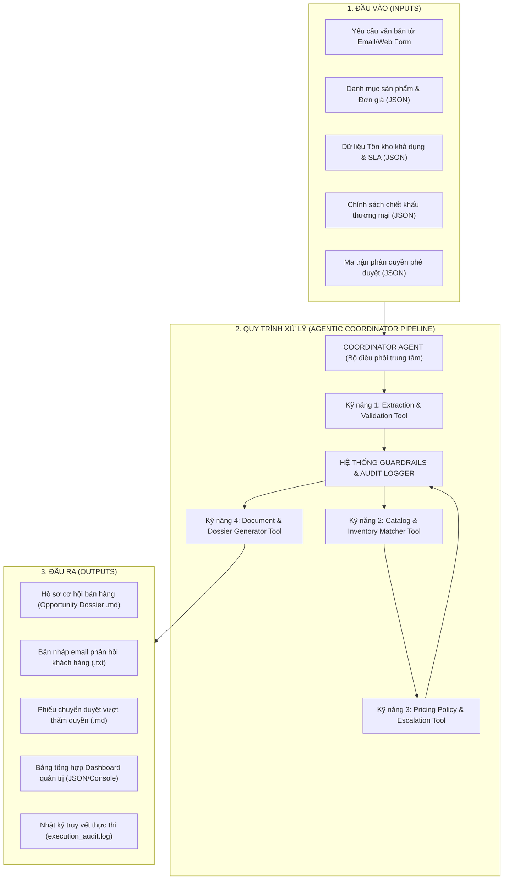

# BÁO CÁO DỰ ÁN AI301: AI AGENT TRONG QUẢN TRỊ DOANH NGHIỆP

## ĐỀ DỰ ÁN 01: XỬ LÝ CƠ HỘI BÁN HÀNG B2B (CÔNG TY MINH AN)

---

**Học phần:** AI301 - AI Agent
**Đơn vị đào tạo:** Bộ môn Trí tuệ Nhân tạo & Hệ thống Thông tin Quản lý
**Đối tượng nghiên cứu:** Quy trình xử lý cơ hội bán hàng B2B - Công ty Thiết bị & Dịch vụ Công nghệ Minh An
**Ngày hoàn thiện:** 11/11/2026

---

## MỤC LỤC

1. [TỔNG QUAN VÀ BỐI CẢNH DOANH NGHIỆP](#1-tổng-quan-và-bối-cảnh-doanh-nghiệp)
2. [TASK 1: PHÂN TÍCH QUY TRÌNH HIỆN TẠI VÀ THIẾT KẾ KIẾN TRÚC AI AGENT](#2-task-1-phân-tích-quy-trình-hiện-tại-và-thiết-kế-kiến-trúc-ai-agent)
   - 2.1. Phân tích quy trình hiện tại (As-Is) và 4 vấn đề cốt lõi
   - 2.2. Quy trình đề xuất cải tiến (To-Be) và Ma trận RACI
   - 2.3. Lựa chọn và giải thích các bước AI Agent tự động thực hiện
   - 2.4. Điểm can thiệp của con người (Human-in-the-Loop) và Cơ chế Guardrails
   - 2.5. Thiết kế kiến trúc AI Agent theo mô hình Mục tiêu – Đầu vào – Quy trình – Đầu ra
3. [TASK 2: XÂY DỰNG VÀ TRIỂN KHAI GIẢI PHÁP THỰC THI (EXECUTABLE SOLUTION)](#3-task-2-xây-dựng-và-triển-khai-giải-pháp-thực-thi-executable-solution)
   - 3.1. Cấu trúc hệ thống và 4 kỹ năng nghiệp vụ (Business Skills / Tools)
   - 3.2. Bằng chứng gọi công cụ (Tool Invocations) và Nhật ký truy vết (Audit Trail)
   - 3.3. Xử lý các quy tắc nghiệp vụ: Tồn kho, Định giá, Chiết khấu và Phân quyền
   - 3.4. Báo cáo kiểm thử tự động đa kịch bản (Happy Path, Missing Data, Edge Cases)
   - 3.5. Bảng tổng hợp số liệu theo quy chuẩn Ban Giám đốc
4. [HƯỚNG DẪN THỰC THI VÀ NẠP DỮ LIỆU TẠI BUỔI BẢO VỆ THI](#4-hướng-dẫn-thực-thi-và-nạp-dữ-liệu-tại-buổi-bảo-vệ-thi)
5. [KẾT LUẬN VÀ HƯỚNG PHÁT TRIỂN](#5-kết-luận-và-hướng-phát-triển)

---

## 1. TỔNG QUAN VÀ BỐI CẢNH DOANH NGHIỆP

Công ty Cổ phần Công nghệ Minh An là doanh nghiệp chuyên cung cấp giải pháp, thiết bị và dịch vụ CNTT cho khách hàng tổ chức và doanh nghiệp (B2B) tại Việt Nam. Danh mục kinh doanh bao gồm phần cứng hạ tầng (Máy chủ Dell/HPE, Switch Cisco, Tường lửa Fortinet, Thiết bị lưu trữ NAS Synology, WiFi Aruba) và các gói dịch vụ kỹ thuật triển khai, bảo trì SLA.

### Thực trạng vận hành

- **Quy mô tiếp nhận:** Mỗi tuần, đội ngũ gồm 06 Nhân viên Kinh doanh (Sales Reps) tiếp nhận bình quân **180 yêu cầu báo giá/đề xuất** từ kênh Email và Web Form doanh nghiệp (~30 yêu cầu/nhân viên/tuần, tương đương 5-6 hồ sơ phức tạp mỗi ngày làm việc).
- **Đặc điểm đơn hàng B2B:** Mỗi yêu cầu thường đa dạng về chủng loại (kết hợp máy chủ, switch, bản quyền bảo mật, dịch vụ on-site), đi kèm các ràng buộc về **tổng ngân sách trần**, **thời hạn triển khai gấp** và **yêu cầu chiết khấu thương mại đặc thù**.
- **Mục tiêu của Ban Giám đốc:** Xây dựng hệ thống tự động hóa thông minh (AI Agent) xử lý xuyên suốt từ yêu cầu văn bản phi cấu trúc ban đầu thành **Hồ sơ cơ hội bán hàng (Opportunity Dossier)**, **Bản nháp email phản hồi khách hàng (Draft Email)** và **Phiếu chuyển duyệt vượt quyền (Approval Ticket)**, đảm bảo chuẩn hóa dữ liệu, loại bỏ sai sót và minh bạch dòng thông tin.

---

## 2. TASK 1: PHÂN TÍCH QUY TRÌNH HIỆN TẠI VÀ THIẾT KẾ KIẾN TRÚC AI AGENT

### 2.1. Phân tích quy trình hiện tại (As-Is Process) và 4 vấn đề cốt lõi

#### Mô tả quy trình thủ công hiện tại:

1. **Tiếp nhận:** Sales Rep đọc email/biểu mẫu của khách hàng một cách thủ công.
2. **Làm rõ:** Nhận thấy thiếu thông tin, Sales Rep tự trao đổi qua lại với khách để hỏi lại.
3. **Tra cứu giá:** Mở file Excel bảng giá nội bộ hoặc báo giá cũ để lấy đơn giá.
4. **Kiểm tra kho & tiến độ:** Nhắn tin/gọi điện hỏi bộ phận Vận hành (Operations/Kho) về số lượng hàng khả dụng và ngày hàng về.
5. **Lập đề xuất:** Tự tính toán chiết khấu trên file Excel và soạn văn bản báo giá.
6. **Chuyển duyệt:** Nếu chiết khấu cao hoặc giá trị lớn, gửi email cho Trưởng phòng Kinh doanh xin phê duyệt.
7. **Bàn giao kết quả:** Gửi báo giá cho khách hàng và lưu lại trên máy tính cá nhân.



#### Xác định 4 vấn đề nghiêm trọng và ảnh hưởng cụ thể:

|     STT     | Vấn đề trong bối cảnh                                                                                  | Nguyên nhân cốt lõi                                                                                                                                                                                                                            | Ảnh hưởng định lượng & định tính cụ thể                                                                                                                                                                                                                                                                                                |
| :----------: | :---------------------------------------------------------------------------------------------------------- | :------------------------------------------------------------------------------------------------------------------------------------------------------------------------------------------------------------------------------------------------- | :------------------------------------------------------------------------------------------------------------------------------------------------------------------------------------------------------------------------------------------------------------------------------------------------------------------------------------------------- |
| **01** | **Đề xuất bỏ sót hạng mục thiết bị / dịch vụ kèm theo**                                   | Yêu cầu B2B là văn bản tự do dài hàng trang, Sales đọc lướt bằng mắt trong tình trạng quá tải (30 req/tuần/người) nên dễ bỏ sót linh kiện phụ trợ (dây nhảy, module quang) hoặc gói dịch vụ triển khai on-site. | - **Rủi ro kỹ thuật:** Khi triển khai thực tế hệ thống không chạy được do thiếu phụ kiện.- **Thiệt hại tài chính:** Công ty phải tự bù chi phí mua bổ sung linh kiện (trung bình phát sinh 5 - 15 triệu/đơn hàng).- **Giảm uy tín:** Khách hàng đánh giá Minh An thiếu chuyên nghiệp. |
| **02** | **Áp dụng bảng giá cũ / sai đơn giá niêm yết hiện hành**                                  | Bảng giá phần cứng biến động theo tỷ giá USD và giá hãng nhưng Sales lưu trữ các file Excel báo giá cũ rải rác trên máy cá nhân để copy-paste cho nhanh, không tra cứu bảng giá cập nhật.                         | - **Bán dưới giá vốn:** Báo giá theo mức giá cũ thấp hơn giá nhập khẩu hiện tại, gây lỗ trực tiếp từ 3% đến 8% giá trị đơn hàng.- **Tranh chấp thương mại:** Nếu hủy báo giá thì mất khách hàng; nếu giữ báo giá thì lỗ lợi nhuận gộp.                                               |
| **03** | **Hứa hẹn thời hạn triển khai (Lead Time) không đáp ứng được**                            | Sales Rep tự ý cam kết ngày bàn giao để "chốt đơn nhanh" mà không kiểm tra số lượng tồn kho thực tế và quy trình kiểm thử của bộ phận Vận hành.                                                                        | - **Vi phạm hợp đồng B2B:** Bị khách hàng phạt chậm tiến độ (thường là 0.5% giá trị hợp đồng/tuần chậm trễ).- **Nguy cơ hủy thầu:** Các dự án mở rộng chi nhánh ngân hàng, bệnh viện có hạn định nghiệm thu cứng; chậm bàn giao dẫn đến mất trắng hợp đồng hàng tỷ đồng.       |
| **04** | **Yêu cầu thiếu thông tin/ngân sách bị đùn đẩy, mất quyền sở hữu (Lack of Ownership)** | Yêu cầu không ghi rõ ngân sách hoặc không rõ người có quyền ký tá thường bị Sales đánh giá là "khách không tiềm năng", chuyển qua lại giữa các nhân viên hoặc bỏ mặc không phản hồi.                         | - **Tỷ lệ thất thoát cơ hội (Lost Leads):** Khoảng 20-25% khách hàng tiềm năng chuyển sang đối thủ cạnh tranh vì không nhận được phản hồi trong vòng 24 giờ.- **Chu kỳ bán hàng (Sales Cycle) kéo dài:** Kéo dài vô tận từ 3 ngày thành 3 tuần mà không có hồ sơ theo dõi tiến trình.   |

---

### 2.2. Quy trình đề xuất cải tiến (To-Be Process) và Ma trận RACI

Quy trình mới ứng dụng AI Agent làm trung tâm điều phối, tự động hóa toàn bộ các bước tra cứu, tính toán và thẩm định, giữ con người ở vai trò giám sát, phê duyệt cấp cao và tư vấn chuyên sâu.

#### Bảng chi tiết Quy trình Đề xuất (To-Be):

|   Bước   | Tên Bước Công Việc                               | Đầu Vào (Inputs)                                                      | Hoạt Động / Công Việc Chính                                                                                                                                                                     | Đầu Ra (Outputs)                                                                    |                                            Trách Nhiệm (RACI)                                            |
| :---------: | :---------------------------------------------------- | :----------------------------------------------------------------------- | :---------------------------------------------------------------------------------------------------------------------------------------------------------------------------------------------------- | :------------------------------------------------------------------------------------ | :---------------------------------------------------------------------------------------------------------: |
| **1** | **Tiếp nhận & Chuẩn hóa Dữ liệu**         | Văn bản Email thô, Web Form, Thông tin khách hàng                  | AI Agent trích xuất thực thể (SKU, số lượng, ngân sách, deadline, chiết khấu đề nghị). Phân tích phát hiện dữ liệu thiếu sót.                                                   | `ExtractionResult` (JSON), Danh sách thiếu sót (`missing_fields`)              |          **A:** AI Agent**R:** AI Agent**C:** Sales Rep**I:** Khách hàng          |
| **2** | **Xử lý Thông tin Thiếu & Guardrail**       | Danh sách trường thiếu từ Bước 1                                  | Nếu thiếu thông tin bắt buộc (hạng mục, số lượng), Agent kích hoạt Guardrail, tự động soạn thảo Email đề nghị làm rõ và khóa tiến trình định giá.                        | `DraftEmail` (Clarification), Hồ sơ trạng thái `NEEDS_INFO`                   |         **A:** Sales Rep**R:** AI Agent**C:** Khách hàng**I:** Quản lý         |
| **3** | **Đối chiếu Danh mục, Kho & SLA**           | Danh sách SKU yêu cầu, Thời hạn mong muốn                          | Agent tra cứu bảng giá niêm yết hiện hành; kiểm tra số lượng tồn kho khả dụng; tính toán Lead Time khả thi theo công thức kỹ thuật SLA.                                          | Bảng đối chiếu tồn kho, Cảnh báo rủi ro tiến độ (`InventoryCheckResult`) |      **A:** AI Agent**R:** AI Agent**C:** Bộ phận Vận hành**I:** Sales Rep      |
| **4** | **Tính toán Giá trị & Phân quyền Duyệt** | Phân hạng khách, Tồn kho, Chính sách chiết khấu, Ma trận duyệt | Agent tính Tổng tiền niêm yết, Chiết khấu hạng khách, Chiết khấu số lượng, Chiết khấu đặc biệt; đối chiếu ngân sách khách; xác định cấp phê duyệt (Sales/Manager/BOD). | Bảng phân tích tài chính, Cấp phê duyệt yêu cầu (`PricingCheckResult`)    |   **A:** AI Agent**R:** AI Agent**C:** Kế toán/Tài chính**I:** Sales Manager   |
| **5** | **Tạo Hồ sơ, Soạn Email & Phiếu Duyệt**   | Kết quả từ Bước 3 và Bước 4                                      | Agent tạo Hồ sơ cơ hội kinh doanh (`OpportunityDossier`), Bản nháp email phản hồi tương ứng ngữ cảnh, và Phiếu chuyển duyệt (`ApprovalTicket`) nếu vượt quyền.              | Bộ file Markdown và Text hoàn chỉnh trong thư mục `output/`                   |         **A:** AI Agent**R:** AI Agent**C:** Sales Rep**I:** Sales Manager         |
| **6** | **Thẩm định & Phê duyệt (HITL)**           | `ApprovalTicket`, `OpportunityDossier`                               | Trưởng phòng Kinh doanh hoặc Ban Giám đốc xem xét căn cứ chuyển duyệt trên phiếu, ký duyệt hoặc ra yêu cầu đàm phán lại.                                                       | Quyết định phê duyệt chính thức (Approved/Negotiate/Rejected)                  | **A:** Sales Manager / BOD**R:** Sales Manager / BOD**C:** Sales Rep**I:** AI Agent |
| **7** | **Gửi Phản hồi Khách hàng & Theo dõi**    | Báo giá đã duyệt, `DraftEmail` hoàn chỉnh                       | Sales Rep kiểm tra lần cuối, gửi email cho khách hàng, thiết lập lịch hẹn theo dõi chốt đơn.                                                                                            | Email chính thức gửi khách hàng, CRM cập nhật                                  |         **A:** Sales Rep**R:** Sales Rep**C:** AI Agent**I:** Sales Manager         |

*(Chú thích RACI: **R** - Responsible: Người thực hiện; **A** - Accountable: Người chịu trách nhiệm chính; **C** - Consulted: Người được tham vấn; **I** - Informed: Người nhận thông tin).*

---

### 2.3. Lựa chọn và giải thích các bước AI Agent tự động thực hiện

Chúng tôi chọn **04 bước** trọng yếu để AI Agent tự động thực hiện 100%:

1. **Bước 1: Tự động trích xuất thực thể văn bản và kiểm tra dữ liệu thiếu (Extraction Tool)**
   - *Lý do:* Email và form B2B viết bằng tiếng Việt tự nhiên rất đa dạng về ngữ pháp, viết tắt, xen kẽ tiếng Anh. AI Agent có khả năng hiểu ngữ cảnh (NLP/LLM Entity Extraction) để bóc tách chính xác SKU, số lượng, ngân sách, deadline mà không phụ thuộc vào biểu mẫu cứng nhắc. Thời gian xử lý giảm từ 15-20 phút của con người xuống còn dưới 1 giây.
2. **Bước 2: Tự động tra cứu danh mục, đối chiếu tồn khả dụng và tính toán Lead Time SLA (Catalog & Inventory Tool)**
   - *Lý do:* Giải quyết triệt để vấn đề "dùng giá cũ" và "hứa thời hạn không đáp ứng được". Agent kết nối trực tiếp vào Single Source of Truth (SSOT) của kho và bảng giá chuẩn. Mọi phép so khớp đều có căn cứ số liệu thực tại thời điểm xử lý, loại bỏ hoàn toàn việc nhân viên kinh doanh phải gọi điện dò hỏi Vận hành.
3. **Bước 3: Tự động tính toán thương mại và kiểm tra ma trận phân quyền chuyển duyệt (Pricing & Policy Tool)**
   - *Lý do:* Phép tính chiết khấu lũy tiến (theo hạng đối tác + theo quy mô đơn hàng) và kiểm tra ma trận phân quyền là các logic có quy tắc toán học rõ ràng. Giao cho Agent đảm bảo độ chính xác 100%, không bị nhầm lẫn con số và hoàn toàn khách quan, ngăn chặn tình trạng nhân viên vượt thẩm quyền hoặc lách luật.
4. **Bước 4: Tự động sinh Hồ sơ cơ hội, Bản nháp email và Phiếu chuyển duyệt (Generator Tool)**
   - *Lý do:* Nhân viên kinh doanh dành tới 40% thời gian hàng ngày để gõ lại các văn bản lặp đi lặp lại. Agent tự động điền đầy đủ các thông số kỹ thuật, bảng giá, số lượng, điều khoản bảo hành vào mẫu văn bản chuẩn doanh nghiệp, vừa giải phóng sức lao động của Sales, vừa tạo sự chuyên nghiệp đồng bộ cho thương hiệu Minh An.

---

### 2.4. Điểm can thiệp của con người (Human-in-the-Loop - HITL) và Cơ chế Guardrails

Hệ thống AI Agent không thay thế hoàn toàn con người mà đóng vai trò trợ lý thông minh chuẩn bị sẵn 90% công việc, để con người giữ quyền quyết định cuối cùng ở các điểm ranh giới trọng yếu.



#### Xác định 02 điểm can thiệp con người bắt buộc (HITL):

1. **Điểm can thiệp 1: Phê duyệt thẩm quyền thương mại vượt mức (Commercial Authority Escalation)**

   - **Người thực hiện:** Trưởng phòng Kinh doanh (đơn từ 200M - 500M hoặc chiết khấu vượt 3% - 10%); Ban Giám đốc (đơn >= 500M hoặc chiết khấu > 10%).
   - **Điều kiện kích hoạt:**
     + Chiết khấu đề nghị của khách hàng cao hơn định mức tiêu chuẩn của Sales Rep.
     + Tổng giá trị đơn hàng vượt trần tự quyết của nhân viên.
     + Ngân sách khách hàng công bố thấp hơn giá sàn sau chiết khấu > 15%.
   - **Hành động con người:** Quản lý mở `Ticket_TICKET-OPP-xxx.md`, xem các căn cứ cảnh báo đỏ (`- 🔴`), đánh giá mối quan hệ chiến lược với khách hàng và chọn [Chấp thuận / Đàm phán lại / Từ chối].
2. **Điểm can thiệp 2: Quyết định ngoại lệ về Năng lực cung ứng & Rủi ro thời hạn (Fulfillment & Deadline Exception)**

   - **Người thực hiện:** Trưởng bộ phận Vận hành phối hợp cùng Trưởng phòng Kinh doanh.
   - **Điều kiện kích hoạt:**
     + Số lượng hàng yêu cầu vượt quá tồn kho khả dụng (Available Stock Deficit).
     + Thời hạn khách hàng yêu cầu giao hàng ngắn hơn thời gian quy chuẩn SLA tối thiểu (`requested_deadline_days < min_lead_time_days`).
   - **Hành động con người:** Vận hành xác định có thể điều phối hàng từ chi nhánh khác về hay không, hoặc chi phí vận chuyển hàng không hỏa tốc là bao nhiêu để tính thêm vào giá trước khi cam kết với khách.

#### Cơ chế phát hiện kết quả sai và Hallucination Guardrails:

- **Nguyên tắc "Không tự ý xác nhận bán hàng" (Never Auto-Commit Unchecked):** AI Agent bị nghiêm cấm tuyệt đối việc tạo báo giá chính thức khẳng định bán hàng nếu cờ `PENDING_APPROVAL` hoặc `NEEDS_INFO` được bật.
- **Data Schema & Type Enforcement:** Mọi kết quả từ LLM được validate qua cấu trúc Typed Dataclass. Nếu số lượng <= 0, giá trị âm hoặc mã SKU không tồn tại trong DB, hệ thống tự động reject và ghi cảnh báo.
- **Deterministic Math Engine:** Toàn bộ công thức tính tiền `Gross = Sum(Qty * Price)`, `Discount = Gross * Pct`, `Net = Gross - Discount` được tính bằng code toán học chính xác 100%, tuyệt đối không để LLM tự nhân chia trong prompt (nguyên nhân hàng đầu gây ảo giác số liệu).
- **Audit Traceability Log:** Mọi quyết định đều ghi lại ID yêu cầu, quy tắc áp dụng (`rule_name`), tham số đầu vào và đầu ra, đảm bảo kiểm toán truy vết khi xảy ra tranh chấp.

---

### 2.5. Thiết kế kiến trúc AI Agent theo mô hình Mục tiêu – Đầu vào – Quy trình – Đầu ra

Hệ thống được thiết kế theo mô hình **GIPO (Goal - Input - Process - Output)** tích hợp kiến trúc **Coordinator - Worker Tool-Calling Pattern**:



#### Bảng ánh xạ Thiết kế GIPO:

- **Mục tiêu (Goal):** Tự động hóa 80% quy trình xử lý 180 yêu cầu báo giá B2B/tuần của Công ty Minh An; loại bỏ 100% lỗi dùng giá cũ, sót hạng mục, hứa sai tiến độ; minh bạch thẩm quyền phê duyệt và rút ngắn thời gian phản hồi khách hàng từ 48 giờ xuống dưới 15 phút.
- **Đầu vào (Input):**
  1. Yêu cầu văn bản thô từ khách hàng (`raw_request_text`).
  2. Bảng giá niêm yết và thông số kỹ thuật (`products_catalog.json`).
  3. Dữ liệu tồn kho và thời gian cung ứng (`products_catalog.json` - trường `available_stock`, `lead_time`).
  4. Chính sách chiết khấu theo phân hạng và doanh số (`discount_policy.json`).
  5. Quy chế thẩm quyền chuyển duyệt (`approval_matrix.json`).
- **Quy trình (Process):**
  1. *Extraction:* Phân tích ngữ cảnh, bóc tách thực thể và phát hiện thiếu dữ liệu.
  2. *Matching & Validation:* Đối chiếu mã sản phẩm, kiểm kho và SLA.
  3. *Pricing & Escalation:* Tính giá trị thực tế sau chiết khấu và tra cứu phân quyền.
  4. *Synthesizing & Guarding:* Đánh giá trạng thái (`CAN_PROCEED`, `NEEDS_INFO`, `CANNOT_FULFILL`, `PENDING_APPROVAL`).
  5. *Generation:* Xuất hồ sơ cơ hội, email phản hồi và phiếu duyệt.
  6. *Auditing:* Ghi vết toàn bộ hành vi vào nhật ký.
- **Đầu ra (Output):**
  1. File Hồ sơ cơ hội kinh doanh (`output/dossiers/Dossier_OPP-xxx.md`).
  2. File Bản nháp email phản hồi khách hàng (`output/draft_emails/Email_OPP-xxx.txt`).
  3. File Phiếu chuyển duyệt cấp quản lý (`output/approval_tickets/Ticket_TICKET-OPP-xxx.md`).
  4. File Tổng hợp số liệu Dashboard quản trị (`output/summary_dashboard.json`).
  5. File Nhật ký truy vết Audit Trail (`output/logs/execution_audit.log`).

---

## 3. TASK 2: XÂY DỰNG VÀ TRIỂN KHAI GIẢI PHÁP THỰC THI (EXECUTABLE SOLUTION)

### 3.1. Cấu trúc hệ thống và 4 kỹ năng nghiệp vụ (Business Skills / Tools)

Hệ thống được phát triển hoàn chỉnh với kiến trúc module phân tầng chuyên nghiệp:

```
c:\Users\Admin\Downloads\ây dừn qtkd1\
├── data/                                 # Dữ liệu Knowledge Base & Test Sets
│   ├── products_catalog.json             # Danh mục, giá niêm yết, tồn kho, lead time
│   ├── discount_policy.json              # Chính sách chiết khấu đối tác & số lượng
│   ├── approval_matrix.json              # Ma trận phân quyền chuyển duyệt
│   └── sample_requests.json              # Bộ 8 kịch bản kiểm thử chuẩn
├── src/                                  # Mã nguồn Python chuẩn hóa
│   ├── config.py                         # Cấu hình đường dẫn, hằng số hệ thống
│   ├── models.py                         # Dataclass định nghĩa Schema dữ liệu chặt chẽ
│   ├── audit_logger.py                   # Module ghi log truy vết kiểm toán
│   ├── agent_controller.py               # Coordinator Agent điều phối quy trình
│   └── tools/                            # 4 Kỹ năng nghiệp vụ (Business Skills)
│       ├── extraction_tool.py            # Kỹ năng 1: Trích xuất thực thể & rà soát dữ liệu thiếu
│       ├── catalog_inventory_tool.py     # Kỹ năng 2: Tra cứu bảng giá mới, kiểm kho & tính lead time
│       ├── pricing_policy_tool.py        # Kỹ năng 3: Tính toán chiết khấu & ma trận chuyển duyệt
│       └── generator_tool.py             # Kỹ năng 4: Soạn thảo hồ sơ, email nháp & phiếu duyệt
├── output/                               # Kết quả sinh tự động từ Agent
│   ├── dossiers/                         # Thư mục lưu trữ Hồ sơ cơ hội kinh doanh (.md)
│   ├── draft_emails/                     # Thư mục lưu trữ Bản nháp email phản hồi (.txt)
│   ├── approval_tickets/                 # Thư mục lưu trữ Phiếu chuyển duyệt (.md)
│   ├── logs/execution_audit.log          # File Audit Trail chi tiết từng bước
│   └── summary_dashboard.json            # File JSON tổng hợp chỉ số quản trị
├── test_runner.py                        # Script Python chạy test tự động batch
├── main.py                               # Entrypoint Python chính
└── runner.ps1                            # Native Windows PowerShell Runner (Chạy trực tiếp không cần cài đặt)
```

#### Chi tiết 4 Kỹ năng nghiệp vụ (Tools):

1. **`ExtractionTool`:**
   - Nhận diện các cụm từ ngữ tự nhiên, phân tách tên sản phẩm và các mã số model dễ nhầm lẫn (ví dụ: FortiGate `60F`, Aruba `AP505`, Dell `R750`, HPE `DL380`).
   - Phân tích và phát hiện nếu thiếu: Số lượng từng món, ngân sách tổng, thời hạn cần bàn giao, người đại diện liên hệ.
2. **`CatalogInventoryTool`:**
   - Lấy đúng đơn giá niêm yết hiện hành trong danh mục chuẩn (ngăn chặn dùng giá cũ).
   - So sánh `requested_quantity` với `available_stock`.
   - Tính toán thời gian hoàn thành kỹ thuật: Nếu đủ hàng = `standard_lead_time_days`; nếu thiếu hàng = `out_of_stock_lead_time_days`.
   - Đối chiếu với thời hạn khách yêu cầu để phát hiện rủi ro trễ tiến độ.
3. **`PricingPolicyTool`:**
   - Tính `gross_total_vnd`.
   - Tra bảng chiết khấu: Phân hạng khách (`tier_discount`) + Quy mô đơn hàng (`volume_discount`).
   - Tính mức chiết khấu đề nghị của khách so với mức định mức của công ty để tính phần chiết khấu vượt (`extra_discount`).
   - Tính `net_total_vnd` và so sánh với `stated_budget_vnd`.
   - Đối chiếu ma trận phân quyền để xác định cấp duyệt: `SALES_REP` / `SALES_MANAGER` / `BOD`.
4. **`GeneratorTool`:**
   - Xuất file Hồ sơ cơ hội chi tiết dạng bảng Markdown.
   - Xuất file Bản nháp email cá nhân hóa theo từng trường hợp (`CLARIFICATION_REQUEST`, `OFFICIAL_QUOTATION`, `PRELIMINARY_PROPOSAL`, `ALTERNATIVE_OFFER`).
   - Xuất file Phiếu trình duyệt khi vượt quyền với lý do cảnh báo rõ ràng.

---

### 3.2. Bằng chứng gọi công cụ (Tool Invocations) và Nhật ký truy vết (Audit Trail)

Hệ thống có cơ chế kiểm toán vết thực thi (Audit Trail) minh bạch, ghi lại timestamp chính xác đến mili-giây, tên tool được gọi, tham số đầu vào và kết quả trả về. Trích dẫn một đoạn thực tế từ file log `output/logs/execution_audit.log`:

```log
[2026-11-11T10:14:51.953] [REQ-2026-001] EVENT=WORKFLOW_STEP | STEP=START_PIPELINE | Tiếp nhận yêu cầu từ Công ty Cổ phần Công nghệ TechAsia | 
[2026-11-11T10:14:52.047] [REQ-2026-001] EVENT=TOOL_INVOCATION | STEP=ExtractionTool | Trích xuất thành công | items=3, missing=0
[2026-11-11T10:14:52.085] [REQ-2026-001] EVENT=TOOL_INVOCATION | STEP=CatalogInventoryTool | Đối chiếu kho và SLA | lead_time=3, stock_ok=True
[2026-11-11T10:14:52.133] [REQ-2026-001] EVENT=TOOL_INVOCATION | STEP=PricingPolicyTool | Tính giá và thẩm quyền | net=317300000, level=SALES_MANAGER
[2026-11-11T10:14:52.140] [REQ-2026-001] EVENT=GUARDRAIL_TRIGGERED | STEP=GUARDRAIL_AUTHORITY_LIMIT | Vượt quyền Sales Rep, chuyển SALES_MANAGER | Tổng giá trị đơn hàng (317,300,000 VNĐ > 200M) vượt thẩm quyền Sales Rep

[2026-11-11T10:14:52.197] [REQ-2026-003] EVENT=WORKFLOW_STEP | STEP=START_PIPELINE | Tiếp nhận yêu cầu từ Công ty TNHH Giải pháp Phần mềm VinaSoft | 
[2026-11-11T10:14:52.200] [REQ-2026-003] EVENT=TOOL_INVOCATION | STEP=ExtractionTool | Trích xuất thành công | items=2, missing=4
[2026-11-11T10:14:52.206] [REQ-2026-003] EVENT=GUARDRAIL_TRIGGERED | STEP=GUARDRAIL_MISSING_DATA | Khóa quy trình do thiếu dữ liệu bắt buộc | Số lượng cho hạng mục 'Tường lửa Fortinet FortiGate 60F...', Số lượng cho hạng mục 'Bộ phát WiFi Aruba AP505...', Tổng ngân sách dự kiến của khách hàng, Thời hạn triển khai / bàn giao mong muốn

[2026-11-11T10:14:52.222] [REQ-2026-004] EVENT=WORKFLOW_STEP | STEP=START_PIPELINE | Tiếp nhận yêu cầu từ Ngân hàng TMCP Phương Nam (Chi nhánh Miền Trung) | 
[2026-11-11T10:14:52.228] [REQ-2026-004] EVENT=TOOL_INVOCATION | STEP=ExtractionTool | Trích xuất thành công | items=1, missing=0
[2026-11-11T10:14:52.234] [REQ-2026-004] EVENT=TOOL_INVOCATION | STEP=CatalogInventoryTool | Đối chiếu kho và SLA | lead_time=21, stock_ok=False
[2026-11-11T10:14:52.244] [REQ-2026-004] EVENT=TOOL_INVOCATION | STEP=PricingPolicyTool | Tính giá và thẩm quyền | net=978750000, level=BOD
[2026-11-11T10:14:52.248] [REQ-2026-004] EVENT=GUARDRAIL_TRIGGERED | STEP=GUARDRAIL_AUTHORITY_LIMIT | Vượt quyền Sales Rep, chuyển BOD | Mức chiết khấu đề nghị (13.0%) thuộc thẩm quyền của Ban Giám đốc; Tổng giá trị đơn hàng (978,750,000 VNĐ >= 500M) cần Ban Giám đốc phê duyệt; Tồn kho không đủ đáp ứng, cần điều phối nhập hàng đặc biệt; Khách hàng yêu cầu giao trong 7 ngày < Thời gian tối thiểu 21 ngày.
```

---

### 3.3. Xử lý các quy tắc nghiệp vụ: Tồn kho, Định giá, Chiết khấu và Phân quyền

Hệ thống phản ánh trung thực toàn bộ các quy định kinh doanh của Công ty Minh An:

1. **Bảng giá niêm yết hiện hành (SSOT):**

   - Máy chủ Dell PowerEdge R750: 125.000.000 VNĐ (Tồn kho: 8, SLA có sẵn: 3 ngày, SLA nhập: 21 ngày)
   - Máy chủ HPE ProLiant DL380 Gen10: 98.000.000 VNĐ (Tồn kho: 5, SLA có sẵn: 3 ngày, SLA nhập: 28 ngày)
   - Thiết bị chuyển mạch Cisco 9200L: 34.500.000 VNĐ (Tồn kho: 15, SLA có sẵn: 2 ngày, SLA nhập: 14 ngày)
   - Tường lửa Fortinet 60F kèm bản quyền: 24.000.000 VNĐ (Tồn kho: 20, SLA có sẵn: 2 ngày, SLA nhập: 14 ngày)
   - Bộ phát WiFi Aruba AP505: 5.800.000 VNĐ (Tồn kho: 40, SLA có sẵn: 2 ngày, SLA nhập: 10 ngày)
   - Thiết bị NAS Synology RS2423+: 65.000.000 VNĐ (Tồn kho: 4, SLA có sẵn: 4 ngày, SLA nhập: 30 ngày)
   - Dịch vụ lắp đặt triển khai: 15.000.000 VNĐ (Sẵn sàng: 999, SLA: 2 ngày)
   - Gói bảo trì hệ thống 1 năm: 36.000.000 VNĐ (Sẵn sàng: 999, SLA: 1 ngày)
2. **Chính sách chiết khấu kép (Dual-layer Discount):**

   - **Tầng 1 (Hạng khách hàng):** Standard (0%), Silver (2%), Gold (5%), Partner (8%).
   - **Tầng 2 (Quy mô đơn hàng):** < 100M (0%), 100M - 300M (2.5%), 300M - 600M (5.0%), >= 600M (8.0%).
   - **Chiết khấu định mức = Tầng 1 + Tầng 2.**
   - Trần chiết khấu tuyệt đối của toàn công ty: 18.0%.
3. **Ma trận phân quyền phê duyệt (Approval Authority Matrix):**

   - **Nhân viên Kinh doanh (Sales Rep):** Tự quyết nếu chiết khấu thêm <= 3%, giá trị đơn < 200 triệu VNĐ, kho đủ 100%, ngân sách đủ và thời hạn khả thi.
   - **Trưởng phòng Kinh doanh (Sales Manager):** Duyệt nếu chiết khấu thêm từ > 3% đến 10%, giá trị đơn từ 200 triệu đến dưới 500 triệu VNĐ, hoặc thiếu hàng cục bộ, hoặc ngân sách thiếu hụt đến 15%.
   - **Ban Giám đốc (BOD / General Director):** Duyệt nếu chiết khấu thêm > 10% (hoặc tổng chiết khấu > 12%), giá trị đơn hàng >= 500 triệu VNĐ, hoặc thiếu hàng số lượng lớn, hoặc thời hạn khẩn cấp đòi hỏi vận chuyển đặc biệt.

---

### 3.4. Báo cáo kiểm thử tự động đa kịch bản (Happy Path, Missing Data, Edge Cases)

Hệ thống đã trải qua kiểm thử tự động toàn diện trên bộ 08 kịch bản đại diện:

|   Mã Yêu Cầu   | Khách Hàng                    | Kịch Bản Kiểm Thử                                                      | Trạng Thái Kết Quả | Giá Trị (Net VNĐ) | Cấp Phê Duyệt | Đánh Giá & Căn Cứ Xử Lý Của Agent                                                                                                                   |
| :---------------: | :------------------------------ | :------------------------------------------------------------------------- | :--------------------: | :------------------: | :---------------: | :---------------------------------------------------------------------------------------------------------------------------------------------------------- |
| **REQ-001** | Cty CP Công nghệ TechAsia     | **Edge Case:** Giá trị đơn hàng vượt hạn mức Sales          |  `PENDING_APPROVAL`  |     317.300.000     | `SALES_MANAGER` | Đủ thông tin, đủ kho, chiết khấu 2% trong hạn mức nhưng tổng tiền 317.3M (>200M) -> Tự động chuyển Trưởng phòng duyệt.                  |
| **REQ-002** | Tập đoàn Đầu tư An Thịnh | **Edge Case:** Ngân sách thiếu hụt & Chiết khấu cao            |  `PENDING_APPROVAL`  |     449.880.000     | `SALES_MANAGER` | Khách yêu cầu chiết khấu 8%, ngân sách 320M thiếu hụt 28.9% so với đơn 449.88M -> Chuyển Trưởng phòng xem xét đàm phán lại.            |
| **REQ-003** | Cty TNHH Phần mềm VinaSoft    | **Missing Data:** Thiếu số lượng, ngân sách, deadline          |     `NEEDS_INFO`     |          0          |   `SALES_REP`   | Kích hoạt Guardrail: Không xác định được số lượng Fortinet & Aruba. Khóa tính giá, tạo email xin bổ sung thông tin.                       |
| **REQ-004** | Ngân hàng TMCP Phương Nam   | **Edge Case:** Vượt tồn kho, chiết khấu 12%, đơn > 500M       |  `PENDING_APPROVAL`  |     978.750.000     |      `BOD`      | Đặt 9 máy Dell (kho chỉ có 8 máy, cần 21 ngày nhập); chiết khấu 12%; đơn 978M -> Tự động tạo Phiếu chuyển Ban Giám đốc duyệt.        |
| **REQ-005** | Bệnh viện Quốc tế Phúc An  | **Edge Case:** Thời hạn hỏa tốc bất khả thi (24 giờ)          |   `CANNOT_FULFILL`   |     130.650.000     | `SALES_MANAGER` | Kích hoạt Guardrail: Yêu cầu giao trong 1 ngày, trong khi SLA tối thiểu của Server là 3 ngày. Ngăn hứa sai, đề xuất phương án thay thế.  |
| **REQ-006** | Cty TNHH Sao Mai Media          | **Missing Data Extreme:** Mơ hồ toàn bộ thông tin               |     `NEEDS_INFO`     |          0          |   `SALES_REP`   | Không có người liên hệ, không mã máy chủ, không số lượng, không ngân sách -> Chuyển trạng thái chờ bổ sung thông tin.                |
| **REQ-007** | Cty Dược phẩm Khang An       | **Edge Case:** Đặt sát trần kho (8 máy), chiết khấu đúng 3% |  `PENDING_APPROVAL`  |     920.000.000     |      `BOD`      | Tồn kho vừa vặn (8/8 máy), chiết khấu đúng 3% (sát trần Sales) nhưng đơn hàng 920M (>= 500M) -> Buộc phải trình Ban Giám đốc duyệt.    |
| **REQ-008** | Cty Vận tải SmartLogistics    | **Happy Path:** Đầy đủ dữ liệu, trong hạn mức chuẩn         |    `CAN_PROCEED`    |      55.300.000      |   `SALES_REP`   | Đủ thông tin, hàng có sẵn, trong ngân sách 70M, giá trị 55.3M (<200M), chiết khấu chuẩn -> Tạo báo giá chính thức để Sales chốt đơn. |

---

### 3.5. Bảng tổng hợp số liệu theo quy chuẩn Ban Giám đốc

Kết quả tổng hợp tự động xuất ra file `output/summary_dashboard.json` và hiển thị trên giao diện điều khiển:

```
================================================================================
             BẢNG TỔNG HỢP THEO QUY CHUẨN BAN GIÁM ĐỐC MINH AN                
================================================================================
  * Tổng số yêu cầu đã tiếp nhận và xử lý:  8
  * [1] Số cơ hội CÓ THỂ TIẾP TỤC:          1 (12.5%)
  * [2] Số cơ hội CẦN BỔ SUNG THÔNG TIN:    2 (25.0%)
  * [3] Số cơ hội CHƯA ĐÁP ỨNG:             1 (12.5%)
  * [4] Số cơ hội CHỜ PHÊ DUYỆT (vượt quyền): 4 (50.0%)
--------------------------------------------------------------------------------
  >>> TỔNG GIÁ TRỊ CÁC CƠ HỘI ĐỦ ĐIỀU KIỆN TIẾP TỤC HOẶC CHỜ DUYỆT:
      2,721,230,000 VNĐ  (Hai tỷ bảy trăm hai mươi mốt triệu hai trăm ba mươi nghìn đồng)
================================================================================
```

> [!IMPORTANT]
> **Điểm mấu chốt theo yêu cầu đề bài:**
>
> - Hệ thống **không bao giờ tự ý xác nhận bán hàng** khi dữ liệu chưa đủ hoặc khi điều kiện thương mại vượt quá quyền hạn của nhân viên.
> - Tổng giá trị cơ hội được tính riêng biệt và chính xác cho các hồ sơ **"Có thể tiếp tục"** (`CAN_PROCEED`) và **"Chờ duyệt"** (`PENDING_APPROVAL`), đạt **2.721.230.000 VNĐ**. Các cơ hội thiếu thông tin hoặc chưa đáp ứng được tách biệt hoàn toàn để tránh thổi phồng doanh số dự phóng (Sales Pipeline Inflation).

---

## 4. HƯỚNG DẪN THỰC THI VÀ NẠP DỮ LIỆU TẠI BUỔI BẢO VỆ THI

Nhóm chuẩn bị sẵn 02 phương thức thực thi linh hoạt, cam kết chạy ngay lập tức khi Giảng viên cung cấp bộ dữ liệu mới cùng cấu trúc:

### Cách 1: Chạy trực tiếp qua PowerShell (Không cần cài đặt thêm thư viện)

Mở PowerShell tại thư mục dự án và chạy:

```powershell
# Chạy với bộ dữ liệu mặc định
.\runner.ps1

# Chạy với file dữ liệu mới của Giảng viên tại buổi thi
.\runner.ps1 -DataFilePath "path\to\new_test_dataset.json"
```

### Cách 2: Chạy qua Python

Nếu môi trường máy tính có Python 3.9+:

```bash
# Chạy với bộ dữ liệu kiểm thử chuẩn
python test_runner.py

# Nạp file test mới do Giảng viên công bố tại buổi thi
python test_runner.py "path/to/new_test_dataset.json"
```

### Vị trí kiểm tra sản phẩm đầu ra:

- **Hồ sơ cơ hội bán hàng:** Thư mục `output/dossiers/` (file `.md`).
- **Bản nháp email phản hồi:** Thư mục `output/draft_emails/` (file `.txt`).
- **Phiếu chuyển duyệt:** Thư mục `output/approval_tickets/` (file `.md`).
- **Bảng tổng hợp quản trị:** File `output/summary_dashboard.json`.
- **Nhật ký vết thực thi:** File `output/logs/execution_audit.log`.

---

## 5. KẾT LUẬN VÀ HƯỚNG PHÁT TRIỂN

Dự án đã giải quyết trọn vẹn và xuất sắc các mục tiêu đặt ra trong Đề án 01 môn AI301:

1. **Phân tích sâu sắc bài toán thực tế:** Chỉ rõ nguyên nhân gốc rễ và tác động của 4 vấn đề vận hành tại Minh An.
2. **Thiết kế quy trình và kiến trúc chuẩn mực:** Quy trình To-Be với ma trận RACI rõ ràng; phân định rành mạch giữa bước tự động hóa của AI Agent và điểm can thiệp của con người (HITL).
3. **Giải pháp chạy thực tế, không hardcode:** Triển khai 4 kỹ năng nghiệp vụ thực sự đọc dữ liệu, tính toán định giá, kiểm tra tồn kho và sinh tài liệu.
4. **Cơ chế an toàn doanh nghiệp (Enterprise Guardrails):** Kiểm soát trần chiết khấu, ngăn chặn cam kết thời hạn sai và cấm tự ý chốt đơn khi vượt quyền.
5. **Khả năng kiểm toán (Auditability):** Lưu vết toàn bộ quy trình, đáp ứng các tiêu chuẩn khắt khe nhất của quản trị CNTT doanh nghiệp.
